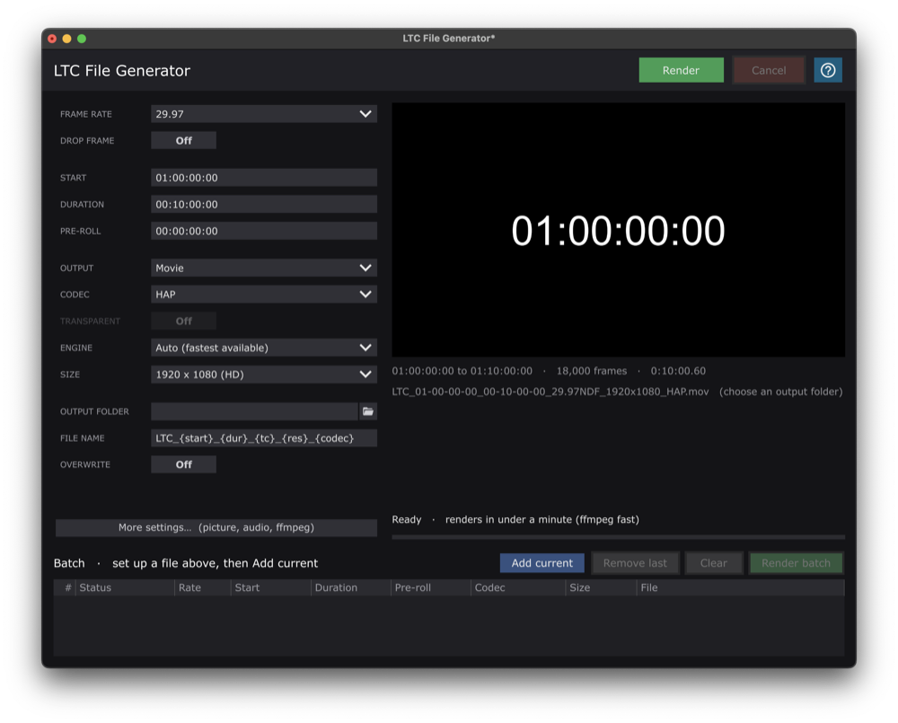

# LTC File Generator

Renders timecode movie files in TouchDesigner: LTC audio, a visual readout and a QuickTime timecode track.



## Getting started

1. Download `LTCfileGen-<version>.toe` from [Releases](https://github.com/jpkelly/TDXLTCfileGen/releases) and open it. (Esc shows the network, F1 returns to the panel.)
2. First time only: click **?** → **Install Now** to get ffmpeg (about 50 MB, no admin rights).
3. Set rate, start, duration, codec and output folder, then click **Render**.

For several files, click **Add current** for each, then **Render batch**.

## Features

- 23.976, 24, 25, 29.97 DF/NDF, 30, 48, 50, 59.94 DF/NDF and 60 fps
- Start, duration and pre-roll; batches
- HAP, HAP Q, NotchLC, ProRes 422 / HQ, H.264, H.265; up to 3840x2160 or custom
- Movie, movie + WAV, or WAV only (an hour of LTC in about 10 s)
- Optional second count, countdown, sync flash, frame marker, info caption
- Adjustable LTC (SMPTE ST 12-1): sample rate, bit depth, channels, level, rise time, user bits
- Every file is read back and checked

## Engines

**Auto** (default) uses **ffmpeg fast** when it can and falls back to **TouchDesigner**. One hour of 59.94 fps HAP: about 3 min fast, about 30 min in TouchDesigner (Apple M4 Max). NotchLC always renders in TouchDesigner.

## Requirements

- TouchDesigner 2025.33230 or later. Tested on macOS only.
- ffmpeg: Install Now, or an existing install (Homebrew, MacPorts, winget, Chocolatey, Scoop). Homebrew's ffmpeg has no HAP encoder, so HAP renders more slowly through TouchDesigner.
- Non-Commercial licences render up to 1280x1280.
- Disk: about 13 GB per hour of 1080p 59.94 HAP.

## In your own project

TouchDesigner users can drop [`td/LTCfileGen.tox`](td/LTCfileGen.tox) into a project. Renders through the TouchDesigner engine change that project's FPS while they run.

## Development

Engine code is plain Python in `src/ltcfilegen`, tested without TouchDesigner:

```sh
/Applications/TouchDesigner.app/Contents/Frameworks/Python.framework/Versions/3.11/bin/python3.11 \
  -m venv --system-site-packages .venv
.venv/bin/pip install pytest
.venv/bin/python -m pytest -m "not slow"
```

In a project saved in the repo folder, with `td/LTCfileGen.tox` dropped in, run in the textport:

```python
exec(open(project.folder + '/tools/td_release.py', encoding='utf-8').read())
link_to_repo()     # use the repo files; release_tox() bakes them back in
```

`tools/td_build_ui.py` builds the panel; `tools/av_check.py` checks renders. To release: `release_tox()`, then `python3 tools/release_toe.py`, and attach the `.toe` from `dist/`.

## Licence

[MIT](LICENSE). Issues: [GitHub](https://github.com/jpkelly/TDXLTCfileGen/issues).
